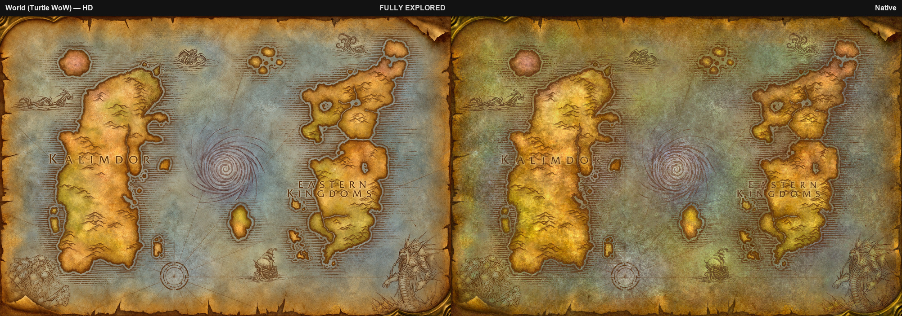
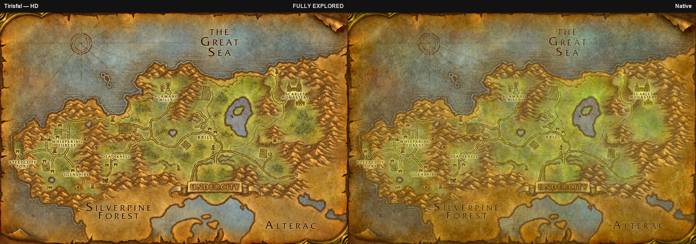
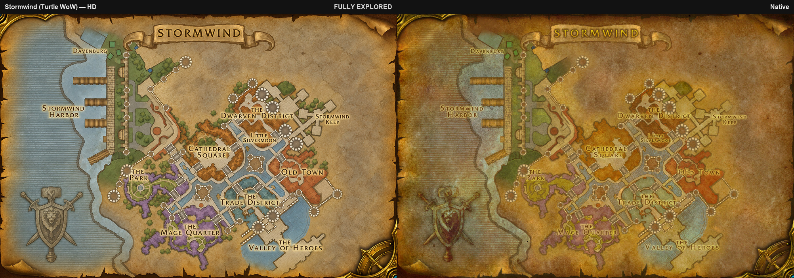
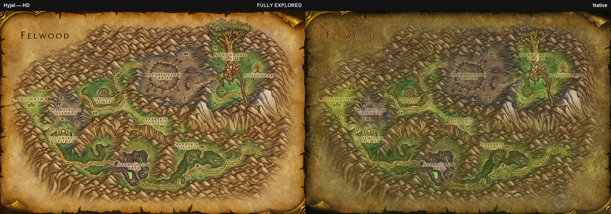
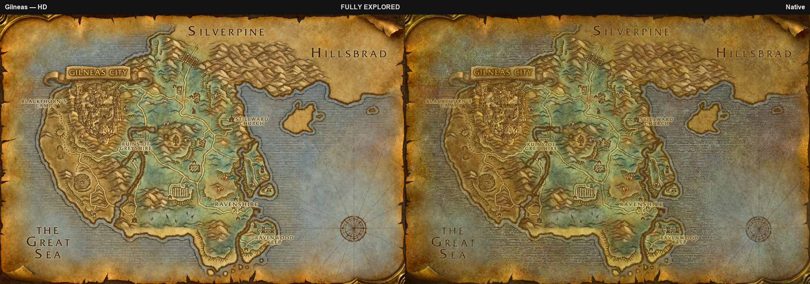
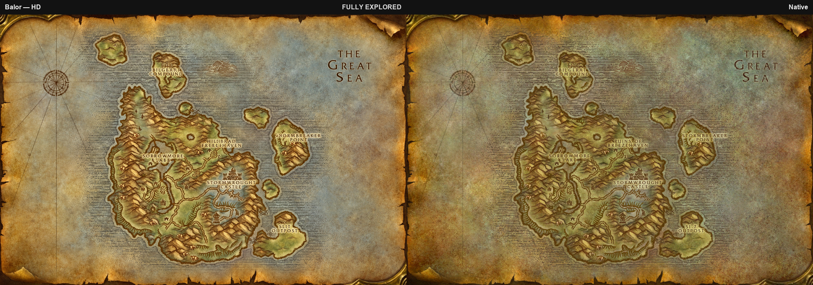
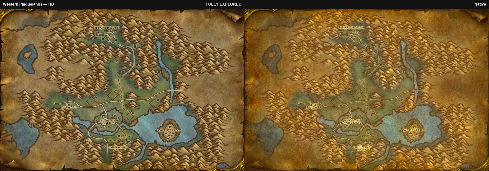
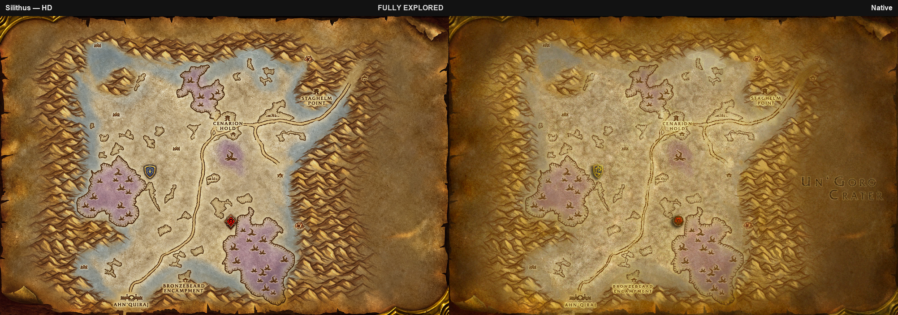



<h1 align="center">PandaMap</h1>

<b>See Azeroth in high definition. Zoom in, and watch it rise in 3D.</b>

Built for the <b>OctoWoW 1.12.1</b> client, including every Turtle WoW zone.

> [!IMPORTANT]
> ## Install
>
> 1. [Download the latest release](https://github.com/Tom75VN/PandaMap/releases/latest/download/PandaMap.zip).
> 2. Extract it into `Wow-Octo\Interface\AddOns\`.
> 3. Check that `pandaMap.toc` sits directly inside the `pandaMap` folder.
> 4. Launch the game, or reload the interface.

## Features at a glance

| | |
|---|---|
| [Exclusive HD maps](#exclusive-hd-maps) | 2x resolution for 54 zones, 6 capitals, 3 battlegrounds and 3 continents |
| [Turtle WoW zones](#every-turtle-wow-zone) | Hyjal, Gilneas, Balor, Tel'Abim and every other new zone, in HD |
| [Mouse-wheel zoom](#zoom-into-the-map) | Up to 4x, centred on your cursor, with smooth glide panning |
| [Resizable minimized map](#resizable-minimized-map) | Drag the corner to make the windowed map any size you like |
| [3D terrain](#3d-terrain) | Zoom in and the parchment turns into a top-down 3D render of the zone |
| [HD unexplored maps](#hd-unexplored-maps) | Even the fog of war is redrawn in HD |
| [Nothing moves](#nothing-moves) | Labels, icons, quest pins, coordinates and clicks stay in place |
| [Low memory](#low-memory) | Nothing loads at login, only the map you open |

## Exclusive HD maps

The original maps were drawn for the screens of 2004. On a modern display they look blurry and washed out. PandaMap swaps them for sharp, richly coloured artwork at **twice the resolution**, created for this addon and found nowhere else.

- **54 zones**: all of Eastern Kingdoms and Kalimdor, plus every Turtle WoW zone, with the explored areas you uncover as you travel.
- **6 capitals**: Stormwind (with the Turtle WoW harbour), Ironforge, Darnassus, Orgrimmar, Thunder Bluff and Undercity.
- **3 battlegrounds**: Alterac Valley, Arathi Basin and Warsong Gulch.
- **3 continent views**: the world map, Eastern Kingdoms and Kalimdor, redrawn with the Turtle WoW islands.

## Every Turtle WoW zone

The new lands get the same treatment as the classic ones: Hyjal, Gilneas, Balor, Tel'Abim, Gillijim's Isle, Alah'Thalas, Thalassian Highlands, Northwind, Grim Reaches, Icepoint, Moonwhisper Coast, Scarlet Enclave, Blackstone Island and the Island of Lapidis. Zones that Turtle WoW reshaped, like Stonetalon Mountains and Tirisfal Glades, are redrawn to match.

<table>
<tr>
<td width="50%"> Hyjal</td>
<td width="50%"> Gilneas</td>
</tr>
<tr>
<td colspan="2"> Balor</td>
</tr>
</table>

## Zoom into the map

The world map finally zooms.

- **Mouse wheel** from 1x to 4x, centred on your cursor, easing smoothly to each step.
- **Double-click** to zoom in one level where you point.
- **Drag to pan**; release fast and the map keeps gliding until it slows down.
- Your zoom survives map updates and panning, and resets when you reopen the map.
- Works hand in hand with pandaUI, PandaQuest and PandaConquest: their pins follow the zoom.

## Resizable minimized map

Play with the map minimized? Make it the size you want.

- **Drag the resize icon** in the bottom-right corner to grow or shrink the map.
- The map keeps its proportions, and the window never grows past the edge of your screen.
- Zoom, panning and every pin keep working at any size.
- Your size is remembered across sessions.

## 3D terrain

Zoom to **x3** and the parchment fades into a **top-down 3D render** of the zone: mountains, valleys, rivers and coasts as they really lie. Zoom back out and the parchment returns.

- Available on all 40 classic outdoor zones.
- Lined up with the map, so your position, quest pins and coordinates stay exactly where they belong.
- Loaded only while it is on screen.
- One switch in the settings turns it off.

## HD unexplored maps

Prefer to keep the fog of war? Unexplored areas are redrawn in HD too, on every one of the 54 zones, so the map looks sharp from your first step into a zone.

Rather see everything right away? **Remove the fog of war** in one click.

## Nothing moves

Every HD map is lined up with the game's own map, so everything you rely on stays exactly where it was: labels, town icons, your player arrow, party members, coordinates, click areas, and the quest pins of PandaQuest.

## Low memory

Better visuals without weighing down your game.

- **Nothing loads at login**: no impact on loading time or memory until you open the map.
- Only the map you are looking at is loaded, and it is released when you close it.
- One fixed set of texture slots is reused for every map, so browsing never makes the addon grow.

## Settings and commands

- A settings window with a minimap button (can be hidden), which becomes a "PandaMap" page in pandaUI's settings when it is installed.
- The interface ships in **English, Russian and Simplified Chinese**.

| Command | What it does |
|---|---|
| `/pmap` | Open the settings |
| `/pmap fog on\|off` | Remove or restore the fog of war |
| `/pmap terrain on\|off` | Turn the 3D terrain on or off |
| `/pmap minimap` | Show or hide the minimap button |

## Version

Current release: 1.0.0

[See what changed](CHANGELOG.md).

## Acknowledgements

PandaMap is a port of [UnrealMap](https://github.com/Tom75VN/UnrealMap) 0.6.0 to the OctoWoW client.

World of Warcraft is a trademark of Blizzard Entertainment. This project is not affiliated with or endorsed by Blizzard Entertainment.
